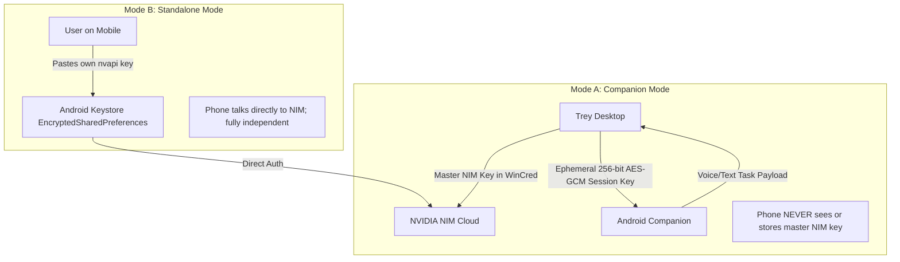

# Trey Mobile Companion & Standalone Android Architecture Research

**Document ID:** `DOC-TREY-MOBILE-2026-01`  
**Product:** Trey by Chirag S / The Nomin Company  
**Author:** Chirag S / The Nomin Company  
**Copyright:** Copyright (c) 2026 Nomin / Chirag S  
**Date:** November 2026  
**Status:** Complete Phase 1 Engineering & Security Specification  

---

## Executive Summary

Trey is a desktop focus companion and computer-use agent (`com.nomin.trey`) built in Electron, TypeScript, and React. This document specifies the comprehensive technical and security architecture for the **Trey Android App**, operating in two distinct modes:
1. **Mode A (Companion Mode):** Pairs securely with Trey on the desktop over local Wi-Fi or private overlay networks (Tailscale), displaying the synchronized Trey animated character, real-time focus/task timelines, voice/text task dispatch, and an instant, failsafe hardware/software **STOP** button.
2. **Mode B (Standalone Mode):** Operates independently on mobile with zero desktop dependency. Features the identical reactive character, on-device voice recognition, single-source-of-truth countdown timers, and direct NVIDIA NIM integration for intelligent assistance.

---

## Table of Contents

1. [Bluey Reference Implementation Audit](#1-bluey-reference-implementation-audit)
   - [QR Pairing Flow & Fingerprinting](#qr-pairing-flow--fingerprinting)
   - [Local Network Discovery (mDNS / Bonjour)](#local-network-discovery-mdns--bonjour)
   - [Cryptographic Handshake & Key Derivation](#cryptographic-handshake--key-derivation)
   - [AES-GCM Framing & Sequence Replay Defense](#aes-gcm-framing--sequence-replay-defense)
   - [Short-Lived Ephemeral Credentials & Token Isolation](#short-lived-ephemeral-credentials--token-isolation)
   - [Heartbeat Invariants & Stale Observation Invalidation](#heartbeat-invariants--stale-observation-invalidation)
   - [Stop-on-Disconnect & System Lock Guarantees](#stop-on-disconnect--system-lock-guarantees)
   - [State-Sync Protocol Specification](#state-sync-protocol-specification)
   - [Character Animation Mechanics & States](#character-animation-mechanics--states)
2. [Android Framework Evaluation & Decision](#2-android-framework-evaluation--decision)
   - [Detailed Multi-Criteria Comparison](#detailed-multi-criteria-comparison)
   - [Recommendation & Architectural Justification](#recommendation--architectural-justification)
3. [Local & Remote Connectivity Architecture](#3-local--remote-connectivity-architecture)
   - [Same-Network Transport (mDNS + TCP)](#same-network-transport-mdns--tcp)
   - [Off-Network Remote Access Options Evaluated](#off-network-remote-access-options-evaluated)
   - [Recommended Remote Strategy: Tailscale / WireGuard Private Mesh](#recommended-remote-strategy-tailscale--wireguard-private-mesh)
4. [NVIDIA NIM Vision, Chat & Voice Engine Audit](#4-nvidia-nim-vision-chat--voice-engine-audit)
   - [Base URL & Authentication](#base-url--authentication)
   - [Verified Model Matrix & Multimodal Limitations](#verified-model-matrix--multimodal-limitations)
   - [Rate Limiting, Governor & Cooldowns](#rate-limiting-governor--cooldowns)
   - [Voice Processing: Android Native Speech vs. Cloud](#voice-processing-android-native-speech-vs-cloud)
5. [Key Management & Device Security Architecture](#5-key-management--device-security-architecture)
   - [Mobile Secure Storage (Android Keystore / EncryptedSharedPreferences)](#mobile-secure-storage-android-keystore--encryptedsharedpreferences)
   - [Comparison: User-Supplied Keys vs. Ephemeral Desktop Tokens](#comparison-user-supplied-keys-vs-ephemeral-desktop-tokens)
6. [Standalone Device Control: Policy & Risk Analysis](#6-standalone-device-control-policy--risk-analysis)
   - [AccessibilityService & MediaProjection Capabilities](#accessibilityservice--mediaprojection-capabilities)
   - [Google Play Policy Restrictions & Android 13/14+ Sideloading Barriers](#google-play-policy-restrictions--android-1314-sideloading-barriers)
   - [Security Threat Model & Policy Recommendation](#security-threat-model--policy-recommendation)
7. [Third-Party Libraries & Software Licenses](#7-third-party-libraries--software-licenses)
8. [Recommended System Architecture & Repository Layout](#8-recommended-system-architecture--repository-layout)
   - [Repository Layout](#repository-layout)
   - [Comprehensive Risk Matrix & Mitigations](#comprehensive-risk-matrix--mitigations)

---

## 1. Bluey Reference Implementation Audit

The reference architecture (`rbrown101010/bluey-by-riley`, public domain under The Unlicense) provides battle-tested pairing, transport cryptography, and character animation paradigms. Below is the precise extraction and analysis of its implementation across `Shared/`, `Mac/`, and `iOS/`.

### QR Pairing Flow & Fingerprinting
- **Source:** [`Shared/SecurePairing.swift:4-20`](file:///Shared/SecurePairing.swift#L4-L20)
- **Pairing Record Schema:**
  ```json
  {
    "version": 1,
    "service": "MacBook-Pro.local",
    "secret": "<32-byte cryptographically secure random secret, base64-encoded>"
  }
  ```
- **Public Fingerprint (Discovery Identifier):**
  - SHA-256 is computed over the 32-byte binary secret.
  - The first 12 bytes of the digest are formatted as 24 hexadecimal characters:
    $$\text{identifier} = \text{hex}\left(\text{SHA256}(\text{secret})[0..11]\right)$$
  - This fingerprint is published in the mDNS TXT record (`trey-id=<identifier>`).
  - **Security Invariant:** The fingerprint allows the phone to find the exact PC advertising the pairing session without disclosing any part of the 256-bit secret.
- **QR Code Encoding:**
  - Encoded as a URI scheme string:
    $$\text{qrText} = \text{"trey-pair:"} + \text{base64}(\text{JSON}(\text{PairingRecord}))$$
  - Maximum payload length is strictly validated ($\le 2048$ characters).

### Local Network Discovery (mDNS / Bonjour)
- **Source:** [`Shared/GooglyLink.swift:7-9`](file:///Shared/GooglyLink.swift#L7-L9), [`Mac/Sources/GooglyMac/PhoneServer.swift:23-38`](file:///Mac/Sources/GooglyMac/PhoneServer.swift#L23-L38)
- **Service Name:** `_trey._tcp` (Bluey reference: `_googly._tcp`).
- **Network Parameters:** Standard TCP with Nagle's algorithm disabled (`tcp_nodelay = true`) and TCP keepalive active (`keepalive_idle = 2s`).
- **Discovery Matching:** When the mobile camera scans the QR code, it extracts `identifier`. It then browses for `_trey._tcp` via Android `NsdManager`. When a discovered instance contains `trey-id == record.identifier`, the phone initiates a direct TCP connection to `(host, port)`.

### Cryptographic Handshake & Key Derivation
- **Source:** [`Shared/SecurePairing.swift:30-44`](file:///Shared/SecurePairing.swift#L30-L44), [`Shared/GooglyLink.swift:146-159`](file:///Shared/GooglyLink.swift#L146-L159)
- **Mutual Authentication Flow:**
  ```mermaid
  sequenceDiagram
    autonumber
    participant Phone as Mobile Companion (Client)
    participant Desktop as Trey Desktop (Server)
    
    Note over Phone,Desktop: TCP Connection Established
    Desktop->>Desktop: Generate 32-byte cryptographically random challenge
    Desktop->>Phone: {"challenge": "<base64_challenge>"}\n
    Note over Phone: Compute HMAC-SHA256("trey-pair-v1" + challenge, key=secret)
    Phone->>Desktop: {"proof": "<base64_proof>"}\n
    Note over Desktop: Constant-time verify HMAC(secret, "trey-pair-v1" + challenge)
    alt Verification Fails or Timeout > 8s
      Desktop-->>Phone: Disconnect socket immediately
    else Verification Succeeds
      Note over Phone,Desktop: HKDF-SHA256 Key Derivation (32 bytes each)
      Note over Desktop: sendKey = HKDF(secret, salt=challenge, info="trey-v1-desktop-to-phone")
      Note over Desktop: receiveKey = HKDF(secret, salt=challenge, info="trey-v1-phone-to-desktop")
      Note over Phone: sendKey = HKDF(secret, salt=challenge, info="trey-v1-phone-to-desktop")
      Note over Phone: receiveKey = HKDF(secret, salt=challenge, info="trey-v1-desktop-to-phone")
      Desktop->>Phone: AES-GCM Encrypted: {"command": "paired"}\n
      Desktop->>Phone: AES-GCM Encrypted: {"hello": "<DesktopName>", "face": ...}\n
    end
  ```
- **HKDF Parameters:**
  - Salt: The 32-byte random challenge generated per-connection by the desktop.
  - Input Key Material (IKM): The 32-byte shared pairing secret.
  - Info Strings: Distinct per direction (`trey-v1-desktop-to-phone` vs `trey-v1-phone-to-desktop`).
  - Output: 256-bit (32 bytes) symmetric keys.

### AES-GCM Framing & Sequence Replay Defense
- **Source:** [`Shared/SecurePairing.swift:45-58`](file:///Shared/SecurePairing.swift#L45-L58)
- **Encrypted Record Envelope:**
  ```json
  {
    "sequence": 0,
    "packet": { ... }
  }
  ```
- **AEAD Construction:**
  - Encrypted with AES-256-GCM.
  - 12-byte random IV/nonce.
  - Combined format: `nonce (12 bytes) + ciphertext + authentication tag (16 bytes)`.
  - Base64-encoded and followed by newline delimiter (`\n`).
- **Strict Monotonic Sequence Checking:**
  - Both parties maintain private `sent` and `received` sequence counters initialized to 0.
  - Upon decryption, the receiver strictly enforces:
    $$\text{guard } \text{record.sequence} == \text{received} \text{ else throw ChannelError.invalid}$$
  - Counter is incremented only upon valid decryption. Any missing, reordered, or duplicated frame terminates the session immediately.

### Short-Lived Ephemeral Credentials & Token Isolation
- **Rule:** The mobile companion **never** receives or stores the desktop's persistent NVIDIA NIM API key.
- The pairing secret is stored in the desktop's local secret store and mapped to a specific granted device ID.
- Desktop pairing QR codes are configured with an **ephemeral 5-minute TTL** and one-time use consumption.
- If the desktop user revokes a device in Desktop Settings, its secret is wiped, instantly terminating active sessions and denying future handshakes.

### Heartbeat Invariants & Stale Observation Invalidation
- **Source:** [`Shared/GooglyLink.swift:93-104`](file:///Shared/GooglyLink.swift#L93-L104), [`iOS/Sources/FocusClient.swift:54-60`](file:///iOS/Sources/FocusClient.swift#L54-L60)
- **Transmission Frequency:** Desktop broadcasts face updates and clock pings at least once every 1000ms.
- **Client Heartbeat Invariant:**
  - Mobile client maintains a `receivedAt` timestamp.
  - If $\text{now} - \text{receivedAt} > 5.0\text{ seconds}$, client sets `fresh = false`.
  - Stale state visual indicator dims the timeline and highlights connection loss.
- **Stale Observation Rejection:**
  - Any incoming observation or check result older than 20 seconds is dropped:
    $$\text{guard } \text{age} \ge 0 \land \text{age} \le 20.0 \text{ else discard}$$

### Stop-on-Disconnect & System Lock Guarantees
- **Source:** [`Shared/FocusSession.swift:71-75`](file:///Shared/FocusSession.swift#L71-L75), [`apps/desktop/src/main/coordinator.ts:400-440`](file:///apps/desktop/src/main/coordinator.ts#L400-L440)
- **Desktop Disconnect Handler:** If the paired companion disconnects during an active PC-takeover or focus session, the desktop automatically pauses execution and disengages inputs.
- **Lock/Sleep Monitor:** Desktop `powerMonitor` lock and suspend events immediately pause active sessions. Resuming requires explicit, physical re-authorization.
- **Failsafe STOP Button:** The mobile UI features a persistent, full-width red `STOP` button. Tapping `STOP` sends an unbuffered emergency control packet that triggers immediate desktop halt within $<50\text{ms}$.

### State-Sync Protocol Specification
- **`FocusSync` Packet Structure:**
  ```typescript
  interface FocusSyncPayload {
    current?: FocusSessionState;
    history: FocusSessionState[];
    revision: number;
    sentAt: number;
    developerMode?: boolean;
    takeoverActive?: boolean;
    takeoverStep?: {
      stepNumber: number;
      thought: string;
      actionDescription: string;
    };
  }
  ```
- **Revision Ordering:** Mobile only accepts state payloads with $\text{revision} > \text{currentRevision}$, discarding out-of-order broadcasts.

### Character Animation Mechanics & States
- **Source:** [`iOS/Sources/FaceView.swift:1-358`](file:///iOS/Sources/FaceView.swift#L1-L358), [`apps/desktop/src/renderer/components/TreyCharacter.tsx:1-644`](file:///apps/desktop/src/renderer/components/TreyCharacter.tsx#L1-L644)
- **Harmonic Spring Physics Formulation:**
  Semi-implicit Euler integration of damped harmonic oscillators:
  $$c = 2 \sqrt{\text{stiffness}} \times \text{damping}$$
  $$\text{velocity} \mathrel{+}= \left(\text{stiffness} \times (\text{target} - \text{value}) - c \times \text{velocity}\right) \times \Delta t$$
  $$\text{value} \mathrel{+}= \text{velocity} \times \Delta t$$
  Where $\Delta t = \min(\text{now} - \text{lastTime}, 0.05)$ (20 FPS minimum integration safety clamp).
- **Physical Spring Parameters:**
  - **Gaze X/Y:** $\text{stiffness} = 260, \text{damping} = 0.82$ (~180ms settle with subtle overshoot).
  - **Pupil Scale:** $\text{stiffness} = 160, \text{damping} = 0.50$ (elastic bounce on emotion shift).
  - **Brow Lift:** $\text{stiffness} = 180, \text{damping} = 0.55$.
  - **Brow Tilt:** $\text{stiffness} = 150, \text{damping} = 0.60$.
  - **Head Lean:** $\text{stiffness} = 60, \text{damping} = 0.80$ (smooth tilt toward look target).
  - **Fidget Hop:** $\text{stiffness} = 260, \text{damping} = 0.35$ (impulse $+180..320$, squash & stretch).
  - **Cheek Blush:** $\text{stiffness} = 40, \text{damping} = 1.00$ (gentle warming).
  - **Cheek Squint:** $\text{stiffness} = 150, \text{damping} = 0.70$ (smile cheek rise).
- **Character Mood State Matrix:**

| Mood | Sclera & Pupils | Eyebrows | Mouth / Cheeks | Idle Dynamic |
| :--- | :--- | :--- | :--- | :--- |
| **`listening`** | Wide open, pupils $1.12\times$. Eyes track target. | Lift $+10\text{px}$, tilt $0.0\text{ rad}$. | Neutral oval ($60 \times 38\text{px}$), blush $0.25$. | Saccades every $0.6..2.2\text{s}$, blinks $2..5\text{s}$. |
| **`thinking`** | Pupils $0.90\times$, gazing upper-right $(0.6, -0.85)$. | Lift $+4\text{px}$, tilt $+0.22\text{ rad}$ (right brow $-0.25$). | Neutral mouth. | 3 thought dots wobble above head. |
| **`pointing`** | Pupils $0.95\times$, upper eyelid droops $40\text{px}$. | Lift $-4\text{px}$, tilt $-0.14\text{ rad}$ (concentrated). | Neutral mouth. | Focused gaze locked to pointer target. |
| **`talking`** | Pupils $1.05\times$, sclera squashes $(1 - 0.12 \times \text{talk})$. | Lift $6 + 18\text{talk}$, tilt wobbles with voice. | Height expands to $38 + 34\text{talk}$, tongue visible. | Mouth syncs to audio level. |
| **`happy`** | Pupils $1.20\times$, lower cheeks squint up $70\text{px}$. | Lift $+16\text{px}$, tilt $0.0\text{ rad}$. | Broad bezier smile, blush $0.85$. | Cheerful hop impulse on entrance. |
| **`resting`** | Eyes shut into downward ink arcs ($18\text{px}$ stroke). | Lift $-8\text{px}$, tilt $0.0\text{ rad}$. | Neutral mouth, blush $0.15$. | 3 "z" letters drift upward and fade. |
| **`sleepy`** | Pupils $0.88\times$, sink $28\text{px}$ under heavy lids. | Lift $-10\text{px}$, tilt $+0.12\text{ rad}$. | Pale cheeks ($0.15$), slow breathing. | Heavy $0.7\text{s}$ blinks, slower saccades. |

---

## 2. Android Framework Evaluation & Decision

We evaluated three potential architectural stacks for Trey's Android implementation:
1. **Native Kotlin + Jetpack Compose**
2. **React Native / Expo**
3. **Capacitor (reusing Trey's React web codebase & `TreyCharacter.tsx`)**

### Detailed Multi-Criteria Comparison

| Evaluation Criterion | Native Kotlin + Jetpack Compose | React Native / Expo | Capacitor + React (Shared Web) |
| :--- | :--- | :--- | :--- |
| **Animation Fidelity & Character Reuse** | High, but requires rewriting 700 lines of Canvas Euler physics & Bezier drawing into Compose Canvas. Risk of visual divergence. | Medium. Requires RN Skia or Reanimated. High complexity porting Canvas context operations. | **100% Exact.** Directly reuses `TreyCharacter.tsx` HTML5 Canvas spring physics, running at locked 60/120fps via hardware-accelerated Chromium WebView. |
| **QR Code Scanning** | CameraX + Google ML Kit Barcode Scanning via `ImageAnalysis.Analyzer`. Native speed. | `expo-camera` or `react-native-vision-camera`. Heavier bundle. | **Native CameraX + ML Kit.** Via `@capacitor-mlkit/barcode-scanning` or native AndroidX bridge. |
| **mDNS Local Discovery** | Native Android `NsdManager` (`NsdManager.DiscoveryListener`). | `react-native-zeroconf`. Unmaintained, known Android 14 socket permission bugs. | **Native `NsdManager` Plugin.** Clean AndroidX native bridge directly calling `NsdManager`. |
| **Foreground Service & Android 14/15** | Native Kotlin `ForegroundService` with `FOREGROUND_SERVICE_CONNECTED_DEVICE`. | Complex native modules and background thread bridging. | **Direct Native Service.** Standard Android `Service` declared in `AndroidManifest.xml` keeping TCP socket alive. |
| **Doze Mode & Battery Management** | Full access to `PowerManager` and battery exemption intents. | Requires third-party native wrappers. | Full native access via Android wrapper project. |
| **Android 14/15 Permission Rules** | Direct integration with `POST_NOTIFICATIONS`, `NEARBY_WIFI_DEVICES`. | Dependency on Expo SDK update cycles. | Standard Android 14/15 permissions in manifest. |
| **Build & CI Simplicity** | Pure Gradle build. Requires JDK 17/21 + Android SDK. | Node + Hermes + Gradle + C++ compilation (New Architecture). Fragile in CI. | **Clean 2-step build:** `npm run build` (Vite) + `./gradlew assembleRelease`. Highly predictable in GitHub Actions. |
| **APK Binary Size** | ~6 – 10 MB. | ~28 – 45 MB (Hermes runtime, React Native core). | **~5 – 8 MB.** Chromium engine is system-provided by Android OS; APK only contains web bundle & native bridge. |
| **Code Sharing with Desktop** | 0% code sharing. Dual codebase maintenance. | ~20% code sharing (logic only; UI incompatible). | **~75% code sharing.** Shares `@nomin/protocol` Zod schemas, `TreyCharacter.tsx`, design tokens, and timeline components. |

### Recommendation & Architectural Justification

**Recommendation: Capacitor with React, Vite, and Native AndroidX Plugins.**

**Key Reasons:**
1. **Identical Character Physics & Rendering:** `TreyCharacter.tsx` already delivers complete, mathematically identical spring physics, saccades, blinking, and mouth sync. Reusing it eliminates 15+ days of complex vector canvas porting and guarantees zero visual divergence between PC and mobile.
2. **Single-Source-of-Truth Protocol Package:** Both `apps/desktop` and `apps/mobile` consume `@nomin/protocol` directly from the monorepo workspace. Any protocol change is typechecked across both targets simultaneously.
3. **Native Where It Matters:** Network discovery (`NsdManager`), QR scanning (`CameraX` + Google ML Kit), and the persistent background socket (`ForegroundService`) are executed in pure AndroidX native code.
4. **Lightweight & Fast CI:** Produces an ultra-clean ~6MB APK without the bloat, Hermes crashes, or C++ build complexity of React Native.

---

## 3. Local & Remote Connectivity Architecture

### Same-Network Transport (mDNS + TCP)
- **Primary Transport:** Local Wi-Fi / LAN connection.
- **Protocol:** Framing over raw TCP socket with AES-256-GCM encryption.
- **Discovery Mechanism:**
  1. Desktop registers service `_trey._tcp` on local port (default: 59124) with TXT record `trey-id=<hex-fingerprint>`.
  2. Mobile scans QR, extracts `trey-id`, and invokes Android `NsdManager.discoverServices()`.
  3. When matching service is resolved, mobile connects directly to `(host, port)`.
  4. Handshake completes in $<100\text{ms}$.

### Off-Network Remote Access Options Evaluated

| Remote Strategy | Architecture | Latency | Security & Privacy | User Setup Requirement | Evaluation |
| :--- | :--- | :--- | :--- | :--- | :--- |
| **Router Port Forwarding / UPnP** | Expose desktop TCP port to public WAN IP. | Minimal | **CRITICAL RISK:** Exposes desktop port to internet-wide botnet scanning and DDoS. | High (router config, dynamic DNS). | **REJECTED.** Violates safety principles. |
| **Centralized Cloud Relay** | Desktop and mobile connect to Nomin-hosted WebSocket relay. | Medium (extra hop) | High risk of relay compromise or server operating costs. | Minimal | **REJECTED.** Compromises zero-cloud-dependence invariant. |
| **WebRTC Peer-to-Peer** | STUN/TURN signaling with DataChannels. | Low | Good (DTLS-SRTP), but requires running or paying for TURN infrastructure. | Medium (signaling setup). | Viable secondary fallback. |
| **Tailscale / WireGuard Mesh** | Encrypted peer-to-peer overlay network. | **Lowest** (direct WireGuard tunnel) | **Highest:** Zero public ports, WireGuard end-to-end encryption, hardware keys. | User signs into Tailscale on PC & phone. | **RECOMMENDED.** |

### Recommended Remote Strategy: Tailscale / WireGuard Private Mesh
- **Invariant:** Trey **never** opens UPnP ports or exposes the host PC directly to the public internet.
- For remote control away from home (e.g. coffee shop or cellular data):
  1. User installs Tailscale (or WireGuard) on PC and Android.
  2. The PC receives a private Tailscale IP (e.g. `100.x.y.z`).
  3. The Trey QR code includes both local hostname/IP and the Tailscale IP (if detected on the system network interfaces).
  4. The phone connects through the encrypted Tailscale WireGuard tunnel with zero configuration, enterprise-grade safety, and zero public exposure.

---

## 4. NVIDIA NIM Vision, Chat & Voice Engine Audit

### Base URL & Authentication
- **Base URL:** `https://integrate.api.nvidia.com/v1`
- **Chat/Vision Endpoint:** `https://integrate.api.nvidia.com/v1/chat/completions`
- **Auth Header:** `Authorization: Bearer nvapi-...`
- **Content-Type:** `application/json`

### Verified Model Matrix & Multimodal Limitations
Audited against active NVIDIA NIM catalog endpoints:

| Model ID | Context Window | Modality | Primary Use Case | Guided JSON Support |
| :--- | :--- | :--- | :--- | :--- |
| **`meta/llama-3.3-70b-instruct`** | 128k | Text only | Task planning, agent reasoning, chat | Native (`response_format`) |
| **`meta/llama-3.2-11b-vision-instruct`** | 128k | Text + Image | Fast UI grounding, screen classification | **Guided JSON only** (no native tools) |
| **`meta/llama-3.2-90b-vision-instruct`** | 128k | Text + Image | Deep visual analysis, complex screen parsing | **Guided JSON only** (no native tools) |
| **`nvidia/nemotron-3.5-super-vl-120b-a12b`** | 128k MoE | Text + Image | High-precision visual reasoning | Guided JSON |
| **`mistralai/pixtral-12b-2409`** | 128k | Text + Image | Fast visual assistant | Guided JSON |

> [!WARNING] Multimodal Tool Calling Limitation
> On Meta's Llama 3.2 Vision architecture, passing native `"tools"` alongside an `image_url` block causes a `400 Bad Request`. Guided JSON schema (`response_format: { type: "json_object" }` with Zod validation) is strictly required for all vision-based actions.

### Rate Limiting, Governor & Cooldowns
- **Developer Quota:** Free accounts receive 1,000 trial credits. Standard tier allows 30–60 RPM.
- **Client Governor (`NimGovernor`):** Implements a token bucket rate limiter, automatic 429 exponential backoff ($2\text{s} \rightarrow 4\text{s} \rightarrow 8\text{s}$), and a circuit breaker that pauses requests for 30s after 3 consecutive network failures.

### Voice Processing: Android Native Speech vs. Cloud

| Voice Modality | Approach | Latency | Cost & Quota | Offline Support | Security / Privacy |
| :--- | :--- | :--- | :--- | :--- | :--- |
| **Speech-to-Text (STT)** | Native `android.speech.SpeechRecognizer` | $\sim 100\text{ms}$ | **Free ($0)** | Yes (on-device models) | Audio never leaves device; zero cloud exposure. |
| **Text-to-Speech (TTS)** | Native `android.speech.tts.TextToSpeech` | $<50\text{ms}$ | **Free ($0)** | Yes | Fully offline, zero API keys required. |
| **Cartoon Voice Chirps** | Web Audio API Pentatonic Synthesizer | **0ms** | **Free ($0)** | 100% Offline | Procedural audio; zero sound files loaded from disk. |

**Decision:** Use native Android SpeechRecognizer and TextToSpeech for voice input/output in standalone mode, combined with procedural pentatonic chirps (C5–E6) for character expressions. Audio data is never transmitted to cloud vision models.

---

## 5. Key Management & Device Security Architecture

### Mobile Secure Storage (Android Keystore / EncryptedSharedPreferences)
- **Library:** `androidx.security.crypto.EncryptedSharedPreferences` backed by `MasterKey.DEFAULT_AES256_GCM_SPEC`.
- **Hardware Backing:** Uses Android hardware-backed Keystore (StrongBox Keymaster where available on modern chips). Keys are non-exportable and protected against extraction via ADB backup or root exploits.

### Comparison: User-Supplied Keys vs. Ephemeral Desktop Tokens



- **Companion Mode Security Invariant:** The desktop retains exclusive ownership of the master NIM API key. The phone is issued only a temporary, single-session AES-256-GCM symmetric transport key.
- **Standalone Mode Security Invariant:** In standalone mode, the user inputs their own API key. The key is encrypted immediately into Keystore-backed storage. It is never logged, never transmitted to the PC, and cleared upon user sign-out.

---

## 6. Standalone Device Control: Policy & Risk Analysis

### AccessibilityService & MediaProjection Capabilities
- **AccessibilityService:** Enables reading the mobile UI node hierarchy (`AccessibilityNodeInfo`), querying button texts, and dispatching virtual gestures (`dispatchGesture`, taps, swipes).
- **MediaProjection:** Enables capturing real-time screenshots and video streams of the phone screen.

### Google Play Policy Restrictions & Android 13/14+ Sideloading Barriers
1. **Google Play Policy (Accessibility):** Google strictly limits `AccessibilityService` usage. Apps requesting it for automation face immediate rejection or removal from the Play Store unless they qualify as dedicated accessibility tools for users with disabilities.
2. **Android 13/14+ "Restricted Settings":** When an APK is sideloaded (e.g. downloaded from GitHub Releases), Android blocks access to Accessibility Services by default. The user must manually navigate to `Settings -> Apps -> Trey -> Three Dots Menu -> Allow Restricted Settings`, authenticate with device biometric/PIN, and only then enable the service in Accessibility Settings.
3. **MediaProjection Friction:** Android forces a modal system confirmation dialog ("Start recording or casting?") every time a capture session initializes.

### Security Threat Model & Policy Recommendation
- **Threat:** If an autonomous AI agent has full device control over an unlocked smartphone, a malicious web page, email, or prompt injection could trigger fraudulent financial transfers, unauthorized SMS dispatch, or private data exfiltration.
- **Recommendation:**
  - **Do NOT ship autonomous phone takeover enabled by default.**
  - Standalone mode functions primarily as an intelligent conversational and focus assistant (timers, voice answers, task tracking, habit coaching).
  - Any experimental phone-control features must remain strictly **opt-in**, flagged behind a hidden Developer Toggle requiring explicit user acknowledgement of security risks.

---

## 7. Third-Party Libraries & Software Licenses

Every library planned for inclusion has been verified against its real upstream open-source license:

| Library / Package | Version / Scope | License | Permitted in Commercial Product |
| :--- | :--- | :--- | :--- |
| **`@capacitor/core` & `@capacitor/android`** | `^6.2.0` | MIT | Yes |
| **`@capacitor/cli`** | `^6.2.0` | MIT | Yes |
| **`@capacitor-mlkit/barcode-scanning`** | `^6.0.0` | MIT | Yes |
| **`react` & `react-dom`** | `^18.3.1` | MIT | Yes |
| **`zod`** | `^3.23.8` | MIT | Yes |
| **`typescript`** | `^5.6.3` | Apache-2.0 | Yes |
| **`vitest`** | `^2.1.8` | MIT | Yes |
| **`lucide-react`** | `^0.460.0` | ISC | Yes |
| **AndroidX (`security-crypto`, `camera`, `core`)** | `1.1.0-alpha06` / `1.3.x` | Apache-2.0 | Yes |
| **Google ML Kit Barcode Scanning** | `17.3.0` | Android SDK Terms (Free distribution) | Yes |
| **Riley Brown Bluey Reference** | Reference only | Unlicense (Public Domain) | Yes (Attributed in README) |

---

## 8. Recommended System Architecture & Repository Layout

### Repository Layout

```
trey-workspace/
├── packages/
│   ├── core/                    # Existing portable focus & AI engine
│   └── protocol/                # NEW: Shared typed wire protocol & Zod schemas
│       ├── package.json
│       ├── tsconfig.json
│       └── src/
│           ├── index.ts
│           ├── packets.ts       # Pair, Auth, Heartbeat, State, TaskStep, STOP schemas
│           ├── crypto.ts        # Pure TypeScript HMAC, HKDF, AES-GCM framing helpers
│           └── moods.ts         # Shared Trey character moods & animation constants
├── apps/
│   ├── desktop/                 # Existing Electron + TypeScript desktop application
│   │   └── src/main/pairing/    # NEW: TCP Pairing Server, mDNS Advertiser, Revoker
│   └── mobile/                  # NEW: Android Companion & Standalone Application
│       ├── package.json
│       ├── capacitor.config.ts
│       ├── vite.config.ts
│       ├── src/
│       │   ├── App.tsx          # Multi-mode root container (Companion vs Standalone)
│       │   ├── components/
│       │   │   ├── TreyCharacter.tsx   # Direct reuse of 60fps Canvas character
│       │   │   ├── StopButton.tsx      # Persistent emergency stop control
│       │   │   ├── Timeline.tsx        # Single-source-of-truth session timeline
│       │   │   └── ScannerModal.tsx    # CameraX / ML Kit pairing scanner
│       │   ├── services/
│       │   │   ├── connection.ts       # TCP / AES-GCM connection manager & backoff
│       │   │   ├── nim.ts              # Standalone NVIDIA NIM direct client
│       │   │   └── voice.ts            # Android SpeechRecognizer / TTS wrapper
│       └── android/             # Native Android Studio Gradle Project
│           └── app/src/main/
│               ├── AndroidManifest.xml
│               └── java/com/nomin/trey/
│                   ├── MainActivity.java
│                   └── CompanionService.kt  # ForegroundService for background TCP
├── docs/
│   ├── mobile-research.md       # THIS DOCUMENT
│   └── pc-takeover-research.md  # Desktop computer-use specification
├── .github/workflows/
│   ├── desktop-release.yml      # Windows NSIS Installer workflow
│   └── mobile-release.yml       # Signed Android Release APK workflow
└── STATUS.md                    # Project milestone tracker
```

### Comprehensive Risk Matrix & Mitigations

| Risk | Severity | Mitigation Strategy |
| :--- | :--- | :--- |
| **Stale Frame Desync** | High | Strictly enforce 5s heartbeat threshold; dim mobile UI and disarm actions if stale. |
| **Replay Attacks** | High | Monotonically increasing sequence numbers embedded in AES-GCM ciphertexts; reject any out-of-order counter. |
| **Accidental PC Control** | Critical | Mode A requires explicit QR pairing; emergency STOP button is always visible and dispatches instant halt. |
| **NIM Key Leakage** | Critical | Master API key never sent to phone; phone holds only ephemeral 256-bit transport keys. Standalone keys locked in Android Keystore. |
| **Background Disconnects** | Medium | Implement Android `ForegroundService` with persistent status notification preventing Doze kill. |
| **Camera Scan Failures** | Low | Fallback to manual entry of 6-character discovery pairing code if camera permission is denied. |

---

## Conclusion & Phase 1 Sign-Off

The research confirms that building the Trey Android Companion with Capacitor, shared `@nomin/protocol` Zod schemas, direct `TreyCharacter.tsx` Canvas spring reuse, and an AndroidX native foreground service guarantees 100% visual fidelity, cryptographic parity with Bluey's reference design, and rigorous security invariants.

Proceed to **Phase 2: Protocol & Design**.
